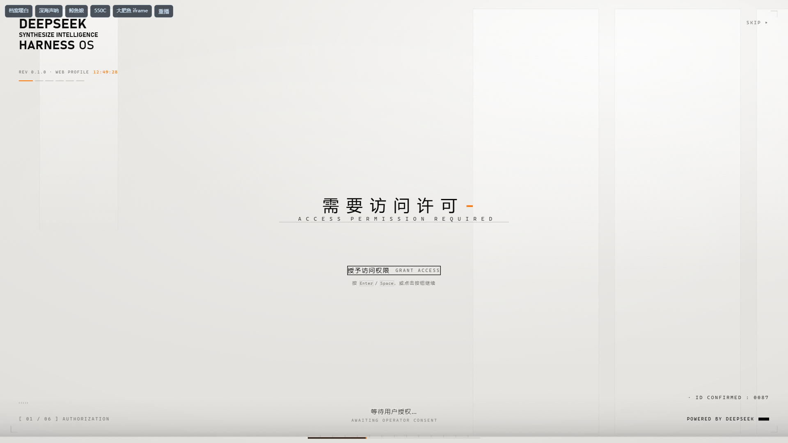

# dsh-boot-animation

[](https://dsh-plugin.org/plugins/alice-marx/dsh-boot-animation)

Replaces the DSH startup page with a chosen or random local video, or with a data-driven boot-screen template (scene steps, a keyframed timeline, or a whole iframe document), then transitions into the app, with configurable playback and fallback controls. It does not modify DSH core source; future compatibility is not guaranteed.

**Language:** English | [简体中文](README.zh-CN.md)

This is a community plugin, not affiliated with or endorsed by DeepSeek.

- **Package:** [`@ljwei-stak/dsh-boot-animation`](https://www.npmjs.com/package/@ljwei-stak/dsh-boot-animation)
- **Release:** [0.6.4](https://github.com/Alice-Marx/dsh-boot-animation/releases/tag/v0.6.4)
- **Repository:** [Alice-Marx/dsh-boot-animation](https://github.com/Alice-Marx/dsh-boot-animation)
- **Topic:** `dsh-plugin`
- **Directory category:** UI & Experience (用户界面与体验), following the [DSH Plugin Hub submission categories](https://dsh-plugin.org/submit). A category choice is not a claim of listing acceptance.

## Screenshots

Local Chromium demo host rendering the actual 0.6.4 boot and card source with sample profile data. These are not screenshots of a signed-in live DSH profile and are not a cross-platform certification.


The clip form: a full-window clip, the progress bar following the real boot, and the hint line.



The template form: the built-in `archive-warm` steps template — the classic
authorisation sequence, waiting for the operator's confirmation.

## Install

### Web

```bash
dsh plugin --profile web add @ljwei-stak/dsh-boot-animation@0.6.4 --save-exact
```

Host and Node requirements must already be met.

### Desktop

Open **Settings -> Plugins -> Add plugin**, paste `@ljwei-stak/dsh-boot-animation@0.6.4`, then quit and reopen from the tray as prompted.

For Desktop upgrades where the live install API reports the package as already installed, fully quit from the tray first and use the official Desktop bundled wrapper — not an older global `dsh` binary.

Windows default-location copyable offline command:

```powershell
& "$env:LOCALAPPDATA\Programs\DeepSeek Harness\resources\runtime\cli\bin\dsh.cmd" plugin --profile desktop add '@ljwei-stak/dsh-boot-animation@0.6.4' --save-exact
```

Adjust the wrapper path if DeepSeek Harness is installed elsewhere. If you use a custom `DSH_HOME`, retain it when running this command. Do not use this exact Windows path on Linux or macOS.

### Uninstall

Web:

```bash
dsh plugin --profile web remove @ljwei-stak/dsh-boot-animation
```

Desktop: use the official plugin UI. Existing custom videos are separate data; review and back them up before manual deletion. A fresh package install auto-registers the scoped bundle; do not manually insert a second bundle entry.

## Configuration

The plugin uses the host profile configuration and a plugin patch file. There is no separate `.env`, INI, or JSON settings loader.

| File | Role |
| --- | --- |
| `<DSH_HOME>/profiles/<profile>/cordis.yml` | Host base configuration. |
| `<DSH_HOME>/profiles/<profile>/cordis.patch.yml` | Plugin configuration edits. The shipped patch mounts id `boot-animation` with name `@ljwei-stak/dsh-boot-animation`. |
| Profile `package.json` | Tracks dependency and `dsh.profile.bundles` via the installer. |

An [example fragment](examples/boot-animation.config.yml) is provided as a config-object reference only; it is not a standalone autoloaded config file.

Settings namespace: `boot-animation`. Prefer the existing settings UI. Preview uses current settings immediately. Reload the Web page for the next startup; on Desktop, fully quit from the tray and reopen for the next startup. Host entry upgrades also require a full process restart.

| Key | Default | Notes |
| --- | --- | --- |
| `enabled` | `true` | Master switch. |
| `fadeMs` | `2000` | Schema range `300`–`5000` ms; UI presets `1000`, `1500`, `2000`, `3000`, `4000`. |
| `enterMode` | `tail` | `tail` dissolves at clip end; `end` fades after playback; `click` loops until entry. |
| `disabledClips` | `[]` | Opaque filenames disabled in the pool. |
| `sound` | `true` | Subject to browser gesture policy. |
| `clickToEnter` | `false` | When enabled, the first pointer press enters immediately; otherwise a press may first unlock audio. |
| `showHint` | `true` | Display entry hint. |
| `form` | `video` | `video` is the clip screen; `template` hands the boot page to the data-driven runtime. |
| `template` | `archive-warm` | Template id for the template form's first act. |
| `template2` | `""` | Optional second act; empty plays none. |
| `tpl` | see below | The template form's own settings (speed, theme, mode, voice, identity, colours, transitions, glass). |

`tpl` is one nested object whose leaves are individually live-editable — the
settings card writes one leaf at a time (`{ op: 'set', path: ['tpl', 'speed'] }`).
Every field the Host does not send keeps the vendored runtime's own default, so a
settings document written before the template form existed is complete as it
stands. The full list, with ranges and defaults, is `TPL_DEFAULTS` in `entry.js`.

## Media

Imported videos are copied to `<DSH_HOME>/profiles/<profile>/data/dsh-boot-animation/videos`. The original selected file is untouched. Legacy bundled assets under `assets/videos` may be replaced by package upgrades; UI import is preferred.

In the UI, open **Settings -> Plugins -> Installed plugins -> 启动动画** — the configuration section is on the plugin's own page, and each row's configure page shows the same card. On DSH 0.2.1 and older the card lives in the “插件配置” list instead. There you can import a video up to 256 MiB, set one clip as startup or enable several for random selection, preview current effects, and remove custom clips after confirmation.

## Boot-screen templates

With `form: template`, the boot page is rendered by the vendored runtime under
`assets/splash/` from a template's pure JSON plus its assets. Three engines ship
and any of them can play: **steps** (a scene sequence with zh/en text, voice and
optional waits), **layers** (a keyframed timeline — text, line, panel, image,
video, chars globe, idcard and more), and **iframe** (a whole document of the
template's own, sandboxed behind a capability token).

Twelve templates are built in, curated to demonstrate each engine. A template
directory dropped into `<DSH_HOME>/profiles/<profile>/data/dsh-boot-animation/templates/<id>/`
joins the list, and a same-named user template overrides the built-in. Templates
written for [dsh-boot-suite](https://github.com/LeeRolling/dsh-boot-suite) run
unchanged — the format is that project's, and the runtime is an adapted copy of
its engine with full attribution in [CREDITS.md](CREDITS.md).

Two invariants are worth knowing before touching this half: a template that
cannot be read or validated falls back to the clip screen (never a blank boot
page), and every route that can read the user's template directory passes the
browser trust fence, which fails closed.

### Music, editor and store

Three more capabilities the template form carries, all ported from the same
upstream project and all held to the same rules:

- **Your own music.** With the template form, the card's BGM section imports an
  audio file (MP3 / WAV / OGG / M4A / AAC / FLAC, up to 100 MB) into the
  profile's data directory — never uploaded anywhere — and picks which track
  plays where: a main track, an optional second with a crossfade, volume, beat
  grid, loops and voice ducking. The stored name is generated rather than taken
  from the request, and the file route re-checks the whitelist before reading.
- **A visual editor.** The card's 打开模板编辑器 opens a full page that edits a
  template as JSON with a live preview stage, saving into the user template
  directory with a timestamped backup of whatever it replaces. The page is
  generated by `tools/vendor-editor.mjs` from the upstream editor, with its
  route base rewritten to this package's.
- **A template store.** The card's 模板商店 section lists published templates —
  the default index is the dsh-boot-suite template library, whose format this
  package plays unchanged — and installs one into the user directory on request.
  The fetch happens on the Host side, bounded and timed out; the document is
  validated before it is written and its id is checked against the index entry
  that named it. A network failure answers the last good list rather than
  hiding the feature.
browser trust fence, which fails closed.

## Compatibility

- **DSH:** minimum `>=0.2.0-rc.2`; integration verified against Windows Desktop runtime `0.2.0-rc.2` and `0.2.1-rc.2`.
- **Node:** `^22.19.0 || >=24.0.0`; ESM.
- **Runtime dependency:** `@deepseek-ai/schemastery` `^3.18.4` (declared as a dependency, not a peer dependency).
- **Browsers:** Chromium, Chrome, and Edge targeted; Firefox is unverified.
- **Platforms:** macOS and Linux script paths exist but were not independently tested in this acceptance.
- **Codecs:** browser-supported codecs are required. H.264/AAC MP4 is preferred. MP4, WebM, M4V, and MOV containers do not guarantee codec decoding.

## Permissions and trust

This Node plugin runs with host OS privileges; there is no per-plugin sandbox.

- **Reads:** shipped scripts and videos.
- **Writes/removes:** imported video copies in the profile data directory.
- **Optimize:** explicitly rewrites a bundled MP4 using Node APIs, with `originals/` backups and `.faststart-work/` scratch space. The runtime does not execute shell commands or `ffmpeg`.
- **Credentials/network:** no model or provider API keys, telemetry, or remote services are used in the plugin runtime. Browser HTTP calls are same-origin. `npm` and GitHub network access are required by the installer and are distinct from runtime behavior.

### HTTP boundary

Custom import, read, and delete routes enforce DSH `connection.requestRejection` authentication and path checks. Bundled clip manifest/video and Optimize routes do not enforce that same hook themselves. Do not assume every route is authenticated.

Use only in a trusted local environment. Remote or reverse-proxy operators must enforce access control for the entire `/plugins/dsh-boot-animation/` prefix. Imported media is not published to GitHub or npm. Videos are served `no-store`, so repeated loads transfer clip data again.

## License

Code is under [MIT](LICENSE). The `LICENSE` declares the bundled MP4 work under the same MIT terms. User-imported media retains its own rights; installing the plugin does not relicense it.

## Reference repositories

- Original code / upstream: [`lxj5820/dsh-boot-animation`](https://github.com/lxj5820/dsh-boot-animation)
- Official DSH host: [`deepseek-ai/deepseek-harness`](https://github.com/deepseek-ai/deepseek-harness)
- Current maintained distribution: [`Alice-Marx/dsh-boot-animation`](https://github.com/Alice-Marx/dsh-boot-animation)

No endorsement by the upstream or host projects is implied.

## Developer notes

Validation commands present in this repository:

```bash
node build-client.mjs      # only if client source changes
node verify/verify-entry.mjs
node verify/verify-degraded.mjs
node verify/verify-options.mjs
node verify/verify-custom-clips.mjs
```

The 0.6.4 release passed 567 checks; this does not imply every Desktop release or operating system was fully end-to-end tested.

See [AGENTS.md](AGENTS.md), [MANUAL.md](MANUAL.md), and [INSTALL.md](INSTALL.md) for development and setup detail. Archived historical notes are kept at [docs/DEVELOPMENT_NOTES.md](docs/DEVELOPMENT_NOTES.md) and are non-authoritative.

## Directory submission

A [ready-to-copy submission draft](docs/PLUGIN_SUBMISSION.md) follows the hub template. The badge confirms the plugin is listed in the community directory; it does not imply official endorsement or a quality guarantee.
