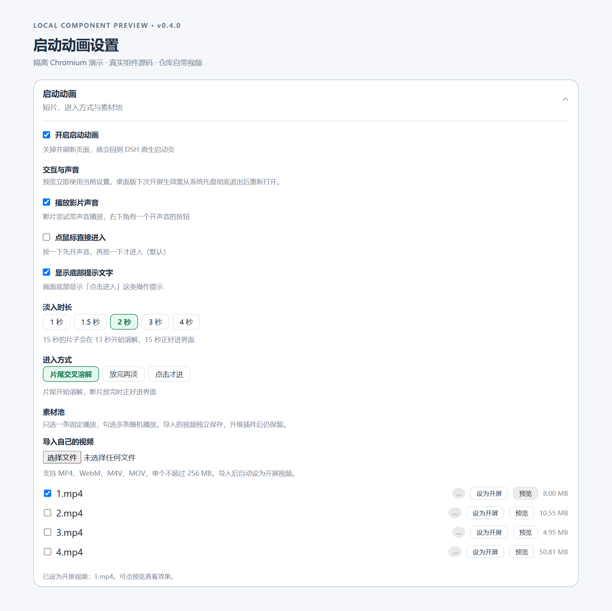

# dsh-boot-animation

[](https://dsh-plugin.org/plugins/alice-marx/dsh-boot-animation)

语言：简体中文 | [English](README.md)

用选定或随机的本地视频替换 DSH 启动页，随后过渡进入应用，并提供可配置的播放与回退控制。它不会修改 DSH 核心源码；未来的兼容性不作保证。

这是一个社区插件，与 DeepSeek 不相关，也未获得 DeepSeek 的认可。

- **软件包：** [`@ljwei-stak/dsh-boot-animation`](https://www.npmjs.com/package/@ljwei-stak/dsh-boot-animation)
- **版本：** [0.4.0](https://github.com/Alice-Marx/dsh-boot-animation/releases/tag/v0.4.0)
- **仓库：** [Alice-Marx/dsh-boot-animation](https://github.com/Alice-Marx/dsh-boot-animation)
- **主题：** `dsh-plugin`
- **目录分类：** UI & Experience（用户界面与体验），遵循 [DSH Plugin Hub 提交分类](https://dsh-plugin.org/submit)。选择类别并不代表已获收录。

## 截图

本地 Chromium 演示宿主渲染了实际的 0.4.0 启动页和设置卡片源码，并附带示例 profile 数据。这些不是已登录的 DSH live profile 截图，也不代表已完成跨平台验证。




## 安装

### Web 版

```bash
dsh plugin --profile web add @ljwei-stak/dsh-boot-animation@0.4.0 --save-exact
```

必须已满足宿主与 Node 的要求。

### 桌面版

打开 **设置 -> 插件 -> 添加插件**，粘贴 `@ljwei-stak/dsh-boot-animation@0.4.0`，然后按提示从托盘彻底退出并重新打开。

对于 Desktop 升级，如果实时安装 API 报告该软件包已安装，请先从托盘彻底退出，然后使用官方 Desktop 捆绑包装器——而不是较旧的全局 `dsh` 可执行文件。

Windows 默认位置的可复制离线命令：

```powershell
& "$env:LOCALAPPDATA\Programs\DeepSeek Harness\resources\runtime\cli\bin\dsh.cmd" plugin --profile desktop add '@ljwei-stak/dsh-boot-animation@0.4.0' --save-exact
```

如果 DeepSeek Harness 安装在其他位置，请相应调整包装器路径。如果你使用自定义 `DSH_HOME`，在运行此命令时请保留该设置。不要在 Linux 或 macOS 上使用这个确切的 Windows 路径。

### 卸载

Web：

```bash
dsh plugin --profile web remove @ljwei-stak/dsh-boot-animation
```

Desktop：使用官方插件 UI。已有的自定义视频是独立数据；在手动删除前，请先检查并备份。新的软件包安装会自动注册 scoped bundle；不要手动插入第二个 bundle 条目。

## 配置

该插件使用宿主 profile 配置和一个插件补丁文件。没有单独的 `.env`、INI 或 JSON 设置加载器。

| 文件 | 作用 |
| --- | --- |
| `<DSH_HOME>/profiles/<profile>/cordis.yml` | 宿主基础配置。 |
| `<DSH_HOME>/profiles/<profile>/cordis.patch.yml` | 插件配置修改。随附的 patch 挂载 id 为 `boot-animation`，名称为 `@ljwei-stak/dsh-boot-animation`。 |
| Profile `package.json` | 通过安装器跟踪依赖和 `dsh.profile.bundles`。 |

提供了一个[示例片段](examples/boot-animation.config.yml)，仅作为配置对象参考；它不是一个独立的自动加载配置文件。

设置命名空间：`boot-animation`。优先使用现有设置 UI。预览会立即使用当前设置。重新加载 Web 页面以进行下一次启动；在 Desktop 上，从托盘彻底退出并重新打开以进行下一次启动。Host entry 升级也需要完整重启进程。

| 键 | 默认值 | 说明 |
| --- | --- | --- |
| `enabled` | `true` | 主开关。 |
| `fadeMs` | `2000` | Schema 范围 `300`–`5000` ms；UI 预设 `1000`、`1500`、`2000`、`3000`、`4000`。 |
| `enterMode` | `tail` | `tail` 在片段末尾溶解；`end` 在播放结束后淡出；`click` 循环直到进入。 |
| `disabledClips` | `[]` | 在池中被禁用的不透明文件名。 |
| `sound` | `true` | 受浏览器手势策略限制。 |
| `clickToEnter` | `false` | 启用后，第一次指针按下会立即进入；否则按下可能先用于解锁音频。 |
| `showHint` | `true` | 显示进入提示。 |

## 视频素材

导入的视频会复制到 `<DSH_HOME>/profiles/<profile>/data/dsh-boot-animation/videos`。最初选中的文件不会被改动。`assets/videos` 下的旧版内置资源可能会被软件包升级替换；推荐使用 UI 导入。

在 UI 中，打开 **设置 -> 插件 -> 启动动画**，可以导入最大 256 MiB 的视频、将一个片段设为启动片或启用多个片段进行随机选择、预览当前效果，并在确认后移除自定义片段。

## 兼容性

- **DSH：**最低 `>=0.2.0-rc.2`；已针对 Windows Desktop 运行时 `0.2.0-rc.2` 和 `0.2.1-rc.2` 验证集成。
- **Node：**`^22.19.0 || >=24.0.0`；ESM。
- **运行时依赖：**`@deepseek-ai/schemastery` `^3.18.4`（声明为依赖，而非 peer dependency）。
- **浏览器：**目标为 Chromium、Chrome 和 Edge；Firefox 未经验证。
- **平台：**macOS 和 Linux 脚本路径存在，但在此验收中未经过独立测试。
- **编解码器：**需要浏览器支持的编解码器。优先使用 H.264/AAC MP4。仅凭 MP4、WebM、M4V 或 MOV 容器格式，无法保证浏览器能够解码。

## 权限与信任

此 Node 插件以宿主 OS 权限运行；没有按插件划分的沙箱。

- **读取：**随附的脚本和视频。
- **写入/移除：**profile 数据目录中导入的视频副本。
- **Optimize：**使用 Node API 显式重写内置的 MP4，并带有 `originals/` 备份和 `.faststart-work/` 临时空间。运行时不会执行 shell 命令或 `ffmpeg`。
- **凭据/网络：**插件运行时不会使用模型或提供商 API 密钥、遥测或远程服务。浏览器 HTTP 调用为同源。安装器需要 `npm` 和 GitHub 网络访问，但这与运行时行为不同。

### HTTP 访问边界

自定义的 import、read 和 delete 路由会强制执行 DSH `connection.requestRejection` 身份验证和路径检查。Bundled clip manifest/video 和 Optimize 路由本身不会强制执行相同的钩子。不要假设每条路由都经过身份验证。

请仅在受信任的本地环境中使用。远程或反向代理运营方必须对整个 `/plugins/dsh-boot-animation/` 前缀强制执行访问控制。导入的媒体不会发布到 GitHub 或 npm。视频以 `no-store` 方式提供，因此重复加载会再次传输片段数据。

## 许可证

代码以 [MIT 许可证](LICENSE)发布。`LICENSE` 声明内置 MP4 作品同样采用 MIT 条款。用户导入的媒体保留其自身权利；安装插件不会对其进行再许可。

## 参考仓库

- 原始代码 / 上游：[`lxj5820/dsh-boot-animation`](https://github.com/lxj5820/dsh-boot-animation)
- 官方 DSH 宿主：[`deepseek-ai/deepseek-harness`](https://github.com/deepseek-ai/deepseek-harness)
- 当前维护的分发：[`Alice-Marx/dsh-boot-animation`](https://github.com/Alice-Marx/dsh-boot-animation)

不暗示上游或宿主项目的任何认可。

## 开发者说明

此仓库中包含的验证命令：

```bash
node build-client.mjs      # only if client source changes
node verify/verify-entry.mjs
node verify/verify-degraded.mjs
node verify/verify-options.mjs
node verify/verify-custom-clips.mjs
```

0.4.0 版本通过了 243 项检查；但这并不意味着每个 Desktop 版本或操作系统都经过了完整的端到端测试。

有关开发和设置详情，请参阅 [AGENTS.md](AGENTS.md)、[MANUAL.md](MANUAL.md) 和 [INSTALL.md](INSTALL.md)。归档的历史记录保存在 [docs/DEVELOPMENT_NOTES.md](docs/DEVELOPMENT_NOTES.md)，不具有权威性。

## 插件目录提交

[一份可直接复制的提交草稿](docs/PLUGIN_SUBMISSION.md)遵循 hub 模板。徽章用于标明插件已收录于社区目录，不代表官方背书或质量保证。
